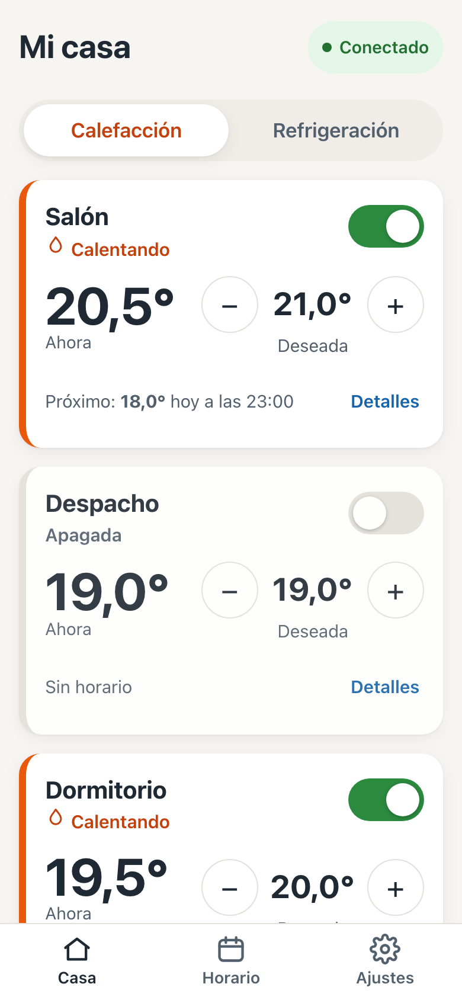
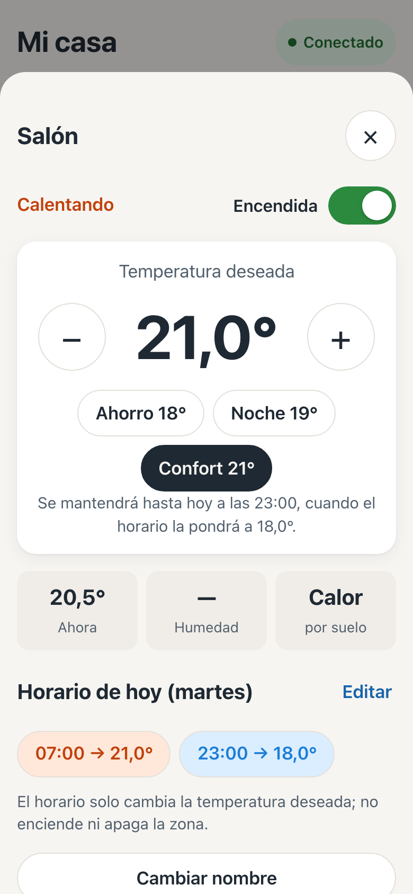
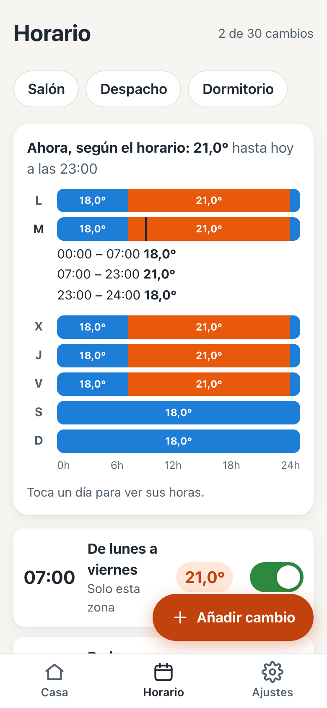
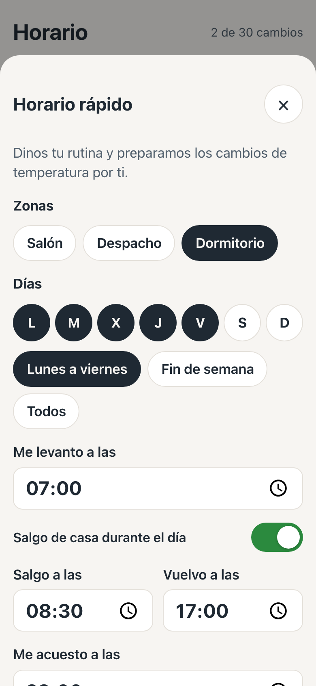

# TermoZona

App **no oficial** para controlar la calefacción por suelo radiante **Orkli TermoWifi**, zona a zona, desde el móvil. Nace para sustituir a la app Orkli iDomus, que es difícil de usar, sobre todo al crear la cuenta y al programar horarios.

- Ves de un vistazo cada zona: temperatura actual, temperatura deseada, si está encendida y si está calentando.
- Subes o bajas medio grado, enciendes y apagas zonas, y cambias entre calefacción y refrigeración.
- Programas horarios con un asistente ("me levanto a las…, me acuesto a las…"), copias el horario de una zona a otras y activas el modo "Me voy unos días".
- El alta de cuenta explica cada error y permite retomar un alta que se quedó a medias.
- Usa la misma cuenta y la misma nube que la app oficial: puedes usar las dos a la vez.

> TermoZona no está hecha ni respaldada por Orkli ni por Ingenium. Úsala bajo tu responsabilidad.

<p>
  
  
  
  
</p>

## Instalar (Android)

1. Abre la [página de descargas](https://github.com/diegogd/termozona/releases/latest) desde el móvil y pulsa el fichero `TermoZona-vX.Y.Z.apk`.
2. Cuando termine la descarga, ábrelo. Si Android pregunta, permite instalar aplicaciones desde el navegador (o desde la app con la que lo hayas abierto). Si Play Protect avisa de que es una app desconocida, elige «Instalar de todos modos».
3. Entra con tu usuario y contraseña de la app de Orkli, o crea una cuenta nueva desde la propia app.

Si nunca has instalado una app fuera de Google Play, esta guía lo explica paso a paso: [Instalar APK en Android: cómo hacerlo y cuáles son los riesgos (Xataka)](https://www.xataka.com/basics/instalar-apk-en-android-como-hacerlo-y-cuales-son-los-riesgos).

**Actualizar:** cuando haya una versión nueva, la app lo avisará con un botón para descargarla. Al abrir el fichero, pulsa «Actualizar»; no se pierde la sesión ni los ajustes.

**iPhone:** de momento no hay versión. Apple no permite instalar apps fuera de la App Store sin pagar su programa de desarrolladores. La app está preparada para funcionar también como web, pero haría falta un pequeño servidor intermedio.

---

# Para desarrolladores

## Layout

| Path | What |
|------|------|
| `app/` | The app: React + TypeScript UI, packaged for Android with Capacitor |
| `app/src/core/` | Platform-independent logic: protocol, cloud API, schedule, controller |
| `app/src/native/` | Capacitor bridge to the Android plugin |
| `app/android/.../OrkliNetPlugin.java` | Native HTTP, TLS socket, FTP, Wi-Fi scan and TermoWifi setup |
| `app/src/demo/` | In-memory cloud + TermoWifi simulator (demo mode, tests) |
| `prototype/orkli_cloud.py` | Python proof of concept of the cloud protocol |
| `docs/CLOUD_PROTOCOL.md` | How the cloud works (reverse-engineered) |

## Why native

A browser cannot open the TLS socket (port 2041) or speak FTP that the Orkli
cloud uses, so the app needs a native layer. Everything above the `Bridge`
interface (`app/src/core/bridge.ts`) is plain TypeScript. To support iPhones
without the App Store later, add a small proxy server and a `proxy` bridge
that tunnels the same calls over a WebSocket; the UI and core stay as they are
and can be served as a PWA.

## Develop

```bash
cd app
npm install
npm run dev          # browser, demo mode only
npx vitest run       # tests
```

## Releases

Push a tag `vX.Y.Z`. `.github/workflows/release.yml` runs the tests, builds,
signs and attaches `TermoZona-vX.Y.Z.apk` to a GitHub Release with
`docs/release-notes.md` as the notes. The app checks GitHub for newer releases
once a day (`app/src/core/updates.ts`).

Repository secrets: `TERMOZONA_KEYSTORE_B64` (base64 of the release keystore)
and `TERMOZONA_KEYSTORE_PASSWORD`. The keystore lives outside the repository;
**losing it means installed apps can no longer be updated**, so keep a backup.

## Build the Android APK

Needs the Android SDK and a JDK (Android Studio's bundled one works):

```bash
cd app
npm run build && npx cap sync android
cd android
JAVA_HOME="/Applications/Android Studio.app/Contents/jbr/Contents/Home" ./gradlew assembleDebug
# app/android/app/build/outputs/apk/debug/app-debug.apk
```

## Prototype

```bash
printf 'ORKLI_USER=…\nORKLI_PASS=…\n' > .env
python3 prototype/orkli_cloud.py --listen 20     # read-only status dump
```

## Status (2026-10-24)

Verified against the real cloud and installation (Android emulator):
login and its error messages (wrong password, unknown user), project download
(zone names, schedule), TLS socket with certificate checks, live zone state,
changing a setpoint (+0.5 °C and back, confirmed by the TermoWifi in 3–7 s),
and saving a schedule: a one-off change for 12:50 (Europe/Madrid) was uploaded
from the app and the cloud applied it between 12:50:00 and 12:51:09, changing
only the setpoint of a zone that was off (it stayed off). The original
`chronos.data` was restored afterwards (`prototype/orkli_cloud.py --upload-chronos`).
Turning a zone on and off was confirmed too. Twice (both about a minute after
starting the emulator) the connection was reset right as a command was
written; commands are now resent after reconnecting, which worked on the real
installation. A second login or a second socket does not cause it (tested).

Not yet tried on the real installation, because they change it:

- heat/cool from the app (it changes the whole house);
- the schedule around a daylight-saving change (the first one is 2026-10-25);
- renaming zones (rewrites `Instal.dat`);
- creating an account, zone discovery and the Wi-Fi setup of a TermoWifi.

Usability reviews of the demo: `docs/usability-review.md` and
`docs/usability-review-2.md`.
